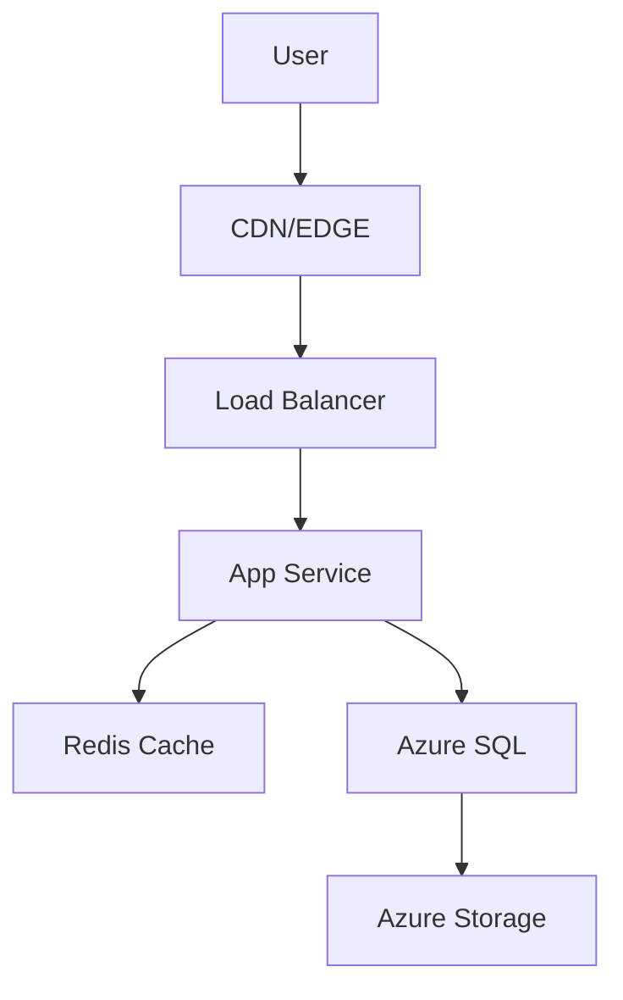

# Azure DevOps Toolkit

Complete Azure DevOps toolkit for infrastructure, deployments, monitoring, and operations. These patterns and frameworks are tested across multiple enterprise deployments.

## When to Use

**Triggers:**
- Deploying and managing Azure resources
- Building DevOps pipelines
- Optimizing Azure costs
- Diagnosing resource health issues
- Creating Azure visualizations
- Managing Azure DevOps projects

**Context:**
- Enterprise Azure deployments
- CI/CD pipeline setup and optimization
- Cost management and optimization
- Infrastructure as Code (Bicep/Terraform)
- Resource monitoring and troubleshooting

---

## Table of Contents

1. [Azure Deployment Preflight](#azure-deployment-preflight) — Pre-deployment validation
2. [Azure DevOps CLI](#azure-devops-cli) — Project and pipeline management
3. [Azure Pricing Optimization](#azure-pricing-optimization) — Cost reduction strategies
4. [Azure Resource Health Diagnosis](#azure-resource-health-diagnosis) — Troubleshooting framework
5. [Azure Resource Visualizer](#azure-resource-visualizer) — Mermaid diagrams and dependency mapping
6. [Azure Role Selector](#azure-role-selector) — RBAC strategy
7. [Azure Static Web Apps](#azure-static-web-apps) — Deployment and configuration

---

## 1. Azure Deployment Preflight

**Purpose:** Comprehensive validation before Azure deployments to prevent costly failures.

### Pre-Flight Validation Checklist

**Infrastructure Checks:**
- Resource group exists or can be created
- Region availability verified
- Quota limits checked (vCPUs, storage, etc.)
- Dependencies validated (network, DNS, certificates)
- Compliance requirements mapped

**Security Checks:**
- RBAC permissions validated
- Network security groups configured
- Key vault access verified
- Private endpoints configured (if needed)
- Policy compliance checked

**Cost Checks:**
- Estimated cost calculated
- Budget alerts proposed
- Reserved instances evaluated
- Cost optimization recommendations applied

**Common Pre-Flight Mistakes:**
- Skipping quota checks → deployment fails mid-way
- Missing network dependencies → resources can't communicate
- Ignoring compliance policies → deployment blocked
- Not validating costs → surprise bills

---

## 2. Azure DevOps CLI

**Purpose:** Manage Azure DevOps resources via CLI for projects, pipelines, repos, and work items.

### Core Commands

**Project Management:**
```bash
az devops project list
az devops project create --name "project-name"
```

**Pipeline Management:**
```bash
az devops pipeline list
az devops pipeline create
az devops pipeline run
```

**Repository Management:**
```bash
az devops Git repo list
az devops Git repo create
```

**Common Workflows:**
- Create project and initialize pipeline
- Set up CI/CD for new application
- Manage repositories and branches
- Trigger pipeline runs manually

---

## 3. Azure Pricing Optimization

**Purpose:** Analyze and optimize Azure resource costs using the Azure Retail API.

### Cost Optimization Strategies

**1. Right-Sizing**
- Analyze actual vs provisioned resources
- Downsize over-provisioned VMs
- Consolidate under-utilized resources

**2. Reserved Instances**
- Evaluate 1-year vs 3-year commitments
- Calculate break-even points
- Automate RI purchases

**3. Spot Instances**
- Use for non-critical workloads
- Build failover strategies
- Monitor interruption patterns

**4. Storage Optimization**
- Move cold data to archival tier
- Lifecycle management policies
- Delete orphaned disks

**5. Azure Advisor**
- Implement recommendations
- Prioritize by impact
- Track savings over time

**Common Cost Patterns:**
- Unattached disks → delete or snapshot
- Overprovisioned VMs → resize
- High egress charges → CDN, edge locations
- Unused resources → auto-shutdown

---

## 4. Azure Resource Health Diagnosis

**Purpose:** Analyze Azure resource health, diagnose issues from logs, and implement resolution patterns.

### Health Investigation Framework

**Step 1: Identify the Issue**
- Resource status in Azure Portal
- Alerts and notifications
- Log Analysis errors
- Activity log events

**Step 2: Determine Scope**
- Single resource or platform-wide?
- Isolated incident or customer-specific?
- Ongoing or intermittent?

**Step 3: Root Cause Analysis**
- Check resource dependencies
- Analyze time-series data
- Review recent changes
- Identify patterns

**Step 4: Resolution**
- Immediate: Rollback, restart, scale
- Short-term: Apply patches, update configs
- Long-term: Architectural changes

**Common Health Issues:**
- VM provisioning failures → check network, storage
- Database timeouts → review connections, scaling
- Storage degradation → check capacity, region
- API throttling → evaluate limits, caching

---

## 5. Azure Resource Visualizer

**Purpose:** Analyze Azure resource groups and generate detailed Mermaid diagrams for architecture documentation.

### Diagram Generation

**Resource Dependency Mapping:**
- Front-end → Back-end → Database → External services
- Network topology (VNet, subnets, peering)
- Security layers (NSG, Firewall, WAF)
- Monitoring integration

**Common Visualization Patterns:**


**Documentation Checklist:**
- All resources labeled clearly
- Data flows marked
- Security boundaries shown
- Regions and availability zones noted

---

## 6. Azure Role Selector

**Purpose:** Guide for selecting appropriate RBAC roles for least-privilege access.

### Role Selection Framework

**Built-in Roles by Scenario:**

**Owner:** Full access, including role management (use sparingly)

**Contributor:** Full resource manage, no RBAC access (good for app devs)

**Reader:** View-only access (good for auditors, monitoring)

**Specific Scenarios:**

**Application Development:**
- Logic App Contributor (for Logic Apps)
- Function App Contributor (for Functions)
- Key Vault Developer (for KV access)

**Infrastructure Management:**
- Virtual Machine Contributor (for VMs)
- Storage Blob Data Contributor (for Blob storage)
- Network Contributor (for networking)

**Monitoring & Operations:**
- Monitoring Reader (for dashboards)
- Log Analytics Reader (for query access)
- User Access Administrator (for RBAC management)

**Least Privilege Checklist:**
- Does role include only needed permissions?
- Can scope be limited to specific resource?
- Can Azure AD groups be used instead of individual assignments?
- Is role necessary for 24/7 operations?

---

## 7. Azure Static Web Apps

**Purpose:** Create, configure, and deploy Azure Static Web Apps for modern web applications.

### Setup and Configuration

**Static Web Apps Features:**
- Static SPA hosting
- Serverless API support
- Azure Functions integration
- Custom domains and SSL
- GitHub/Azure DevOps CI/CD integration

**Configuration Patterns:**

**Basic Setup:**
- Connect GitHub repository
- Choose framework (React, Vue, Angular, Next.js, etc.)
- Configure build settings
- Deploy preview environments

**Advanced Patterns:**
- Multiple environments (staging, production)
- Custom routing rules
- Authentication integration (Azure AD, GitHub, etc.)
- API versioning

**Common Issues:**
- Build fails → check framework config
- API returns 404 → configure route mapping
- Authentication fails → check identity provider
- CORS errors → configure allowed origins

---

## Common Mistakes Across Azure Operations

**1. Over-provisioning resources**
Always start small and scale. Right-size based on actual usage.

**2. Ignoring cost alerts**
Set budget alerts early. Review monthly cost reports.

**3. Missing network dependencies**
Map all resource dependencies before deployment.

**4. Skipping compliance checks**
Azure Policy can block or delay deployments. Know your requirements.

**5. Not planning for failures**
Design for redundancy from the start. Test failover scenarios.

**6. Using Owner roles**
Least privilege applies to admins too. Use specific roles.

**7. No cost governance**
Tag resources. Use cost allocation. Set spending limits.

---

## Quick Reference

**Deployment Checklist:**
- [ ] Pre-flight validation complete
- [ ] Quotas verified
- [ ] Network configured
- [ ] Security policies compliant
- [ ] Cost estimated
- [ ] Rollback plan ready

**Cost Optimization:**
- Right-size VMs
- Use Reserved Instances
- Implement lifecycle management
- Delete unused resources
- Monitor with Azure Advisor

**RBAC Principles:**
- Least privilege
- Specific scopes
- Azure AD groups
- Regular audits

**Common Tools:**
- Azure CLI (`az` commands)
- Azure DevOps CLI (`az devops`)
- PowerShell (`Az` module)
- Azure Portal (for visual inspection)

---

*Comprehensive Azure DevOps skill combining infrastructure, deployments, monitoring, and cost optimization patterns. Includes all Azure tooling skills consolidated for efficient cloud operations across enterprise deployments.*